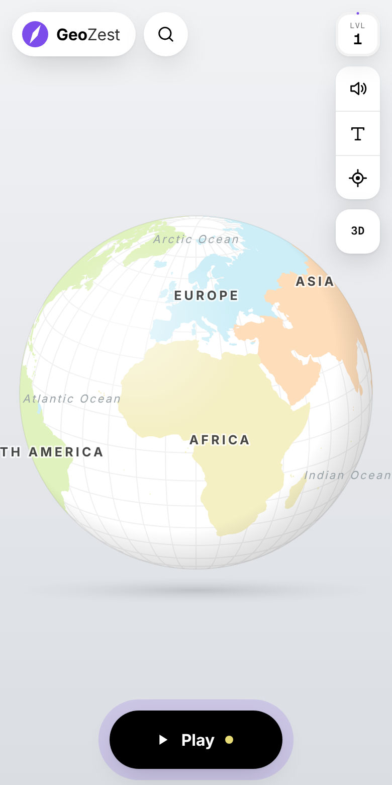
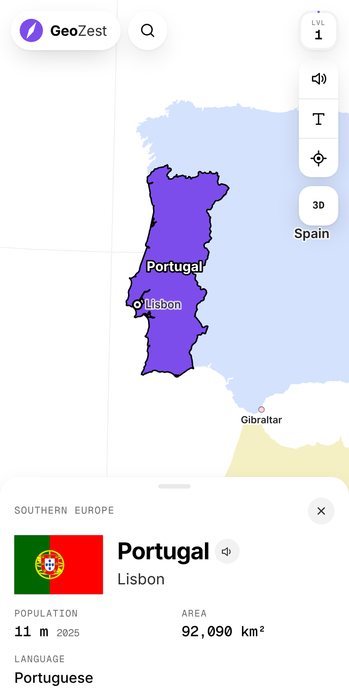
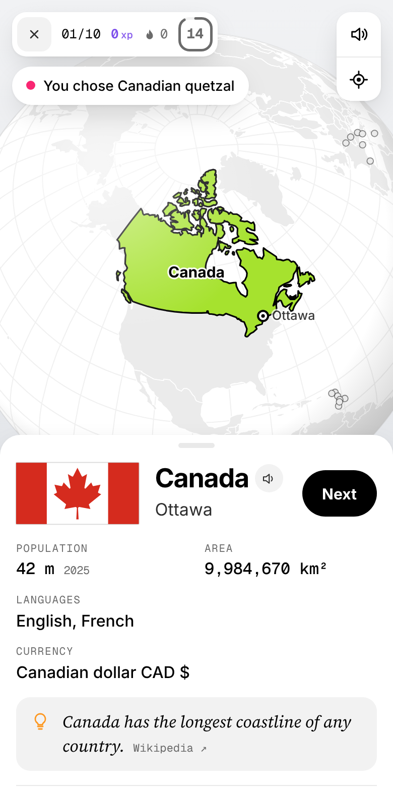
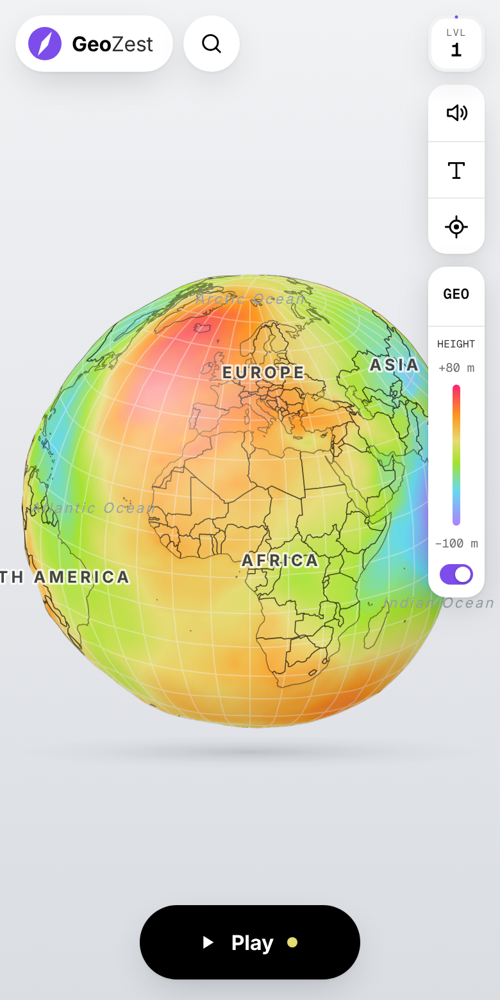

<div align="center">

# GeoZest

[](https://aumgupta.github.io/GeoZest/)
[](https://github.com/sponsors/AumGupta)
[](https://github.com/AumGupta/GeoZest/stargazers)
[](LICENSE)

<picture>
  <source media="(prefers-color-scheme: dark)" srcset="docs/assets/logo-light.svg">
  
</picture>

GeoZest is a minimal, map-first geography quiz game. Explore every country on a 3D globe, hear how places are said in their own languages, and test yourself on maps, flags, capitals, languages, currencies and borders.

**Try it:** [aumgupta.github.io/GeoZest](https://aumgupta.github.io/GeoZest/)

</div>

## Features

- Opens on a 3D globe facing your location.
- Four map views: Globe, Geoid (EGM96 heights), Equal Earth and Mercator, with smooth morphs between them.
- Country cards with population, area, languages, currency, borders and a fun fact.
- Native pronunciations of country names, capitals and languages, with IPA.
- Seven quiz modes: Locate, Identify, Capitals, Flags, Languages, Currencies and Neighbors, for the whole world or any mix of continents, with or without small islands and territories.
- No giveaway questions. If an answer contains the country's name, the wrong options are made just as convincing.
- A daily challenge, XP levels, mastery by region and 15 achievements with bronze, silver and gold tiers.
- Light and dark themes, km or miles, a blank-map mode without labels and a reduce-motion option.
- Works on phone and desktop, no sign-up. Progress is saved in the browser and can be backed up to a file.
- Installable as an app from the browser, and works offline once loaded.

## Screenshots

<p>
  
  
  
  
</p>

## How Scoring Works

### XP in a quiz

Everything is counted in **XP**, the same points that fill up your level.

- A correct answer earns **10 XP**. A wrong answer earns 0.
- **Speed bonus:** with the timer on, you get up to **5 extra XP** for answering fast. The bonus shrinks as the countdown runs and is gone at zero.
- **Streak bonus:** every correct answer in a row adds **10%** to the next one, up to double XP after 10 in a row. A wrong answer resets the streak.

For example, answering with 12 of 15 seconds left as your fourth correct answer in a row gives (10 + 4) × 1.3 = **18 XP**.

### Bonuses and levels

At the end of a quiz you also get **10 XP** for finishing, **25 XP** for a perfect round and **50 XP** for the daily challenge.

Each level needs 100 XP more than the one before: 100 XP to reach level 2, 200 more to reach level 3, and so on.

### Mastery

- A country counts as **mastered** in a mode when your latest answer about it was right. Get it wrong later and it drops out again.
- **Mastery %** shows how much of each region you have mastered in each mode.
- **Known** counts the countries you have mastered in at least one mode.

### Which questions you get

Questions are picked to help you learn. Countries you got wrong come back more often, new ones come up normally, and ones you already know show up less.

### Daily challenge and streaks

- The **Daily challenge** is a new task each day, the same for everyone, like "Recognise 6 flags in Africa". You can play it once a day, and finishing it earns a **50 XP bonus**.
- Your **day streak** counts the days in a row on which you finished at least one quiz.

## How Your Progress Is Saved

- Everything is saved **in your browser only**, using local storage. There is no account, no server and no tracking, so nothing about you leaves your device.
- It saves after every answer, so closing the tab mid-quiz loses nothing.
- What is saved: your XP, your last answer for each country in each mode, achievements, days played, daily results, your last 50 quizzes and your settings.
- Progress stays in the browser and device you played on. It does not sync to other devices, and clearing your browser's site data erases it.
- To move it to another device, open **Settings > Progress > Back up** to download a file, then use **Restore** on the other device.
- To start over, open your level (top right), tap the gear for **Settings**, then use **Progress > Reset**. Your settings are kept.
- The offline cache only stores the app's own files, never your progress.

## Development

### Tech Stack & Libraries Used

- Plain HTML, CSS and JavaScript. No framework and no build step for the app.
- [D3](https://d3js.org/) for projections and [TopoJSON](https://github.com/topojson/topojson-client) for borders, drawn on a single canvas.
- Web Audio for sound effects.

### Project Structure

```
index.html          page markup
css/style.css       all styles, light and dark themes
js/core.js          state, storage, sound, helpers and fun facts
js/map.js           flat map renderer, gestures and labels
js/globe.js         3D globe, geoid view and projection morphs
js/ui.js            sheets, country cards, pronunciation, search and settings
js/quiz.js          question generator and quiz flow
js/main.js          wiring and start-up
js/pwa.js           registers the offline cache
data/geo.js         countries, borders, flags, time zones and geoid grid (generated)
data/say/           pronunciation clips, one file per country
fonts/              bundled web fonts (SIL OFL)
icons/              app icons
sw.js               offline cache
manifest.webmanifest  name, colours and icons used when installed
scripts/            script that rebuilds data/geo.js
```

### Run Locally

The app is static, but it loads pronunciation clips with `fetch`, so serve it rather than opening the file directly.

```
git clone https://github.com/AumGupta/GeoZest.git
cd GeoZest
npm start
```

Any static server works too, for example `python3 -m http.server`.

### Rebuild the Data

`data/geo.js` is already included. To regenerate it from the source packages:

```
npm install
npm run build:data
```

### How to Contribute

1. Fork the repository.
2. Clone your fork:

   ```
   git clone https://github.com/<your-username>/GeoZest.git
   ```
3. Run it locally, make your changes and test on both phone and desktop sizes.
4. Submit a Pull Request with your improvements.

## Data & Credits

- Borders: [Natural Earth](https://www.naturalearthdata.com/) via [world-atlas](https://github.com/topojson/world-atlas).
- Vatican City outline: [geoBoundaries](https://www.geoboundaries.org/) (gbOpen), since it is too small to survive the simplified Natural Earth data.
- Country details: [world-countries](https://github.com/mledoze/countries).
- Capitals: [SimpleMaps World Cities](https://simplemaps.com/data/world-cities) (CC BY 4.0).
- Population: [World Bank](https://data.worldbank.org/indicator/SP.POP.TOTL), latest year per country.
- Geoid: EGM96.
- Flags: Wikimedia Commons.
- Fonts: [Inter](https://rsms.me/inter/), [Geist Mono](https://vercel.com/font) and [Source Serif 4](https://github.com/adobe-fonts/source-serif), all under the SIL Open Font License, bundled so the app looks the same on every device.
- Pronunciation: AI4Bharat Indic-TTS, Kokoro, Piper, Mimic 3, Coqui and Meta MMS voices, with eSpeak NG as a fallback. IPA from eSpeak NG.

## License

GeoZest is licensed under the [GNU General Public License v3.0 (GPL-3.0)](LICENSE).

## Support & Feedback

For suggestions, feature requests, or bug reports, open an issue on the [Issues](https://github.com/AumGupta/GeoZest/issues) page.

If you enjoy GeoZest, consider [supporting the project](https://github.com/sponsors/AumGupta) or starring the repository on GitHub.
